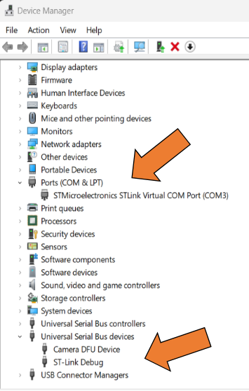
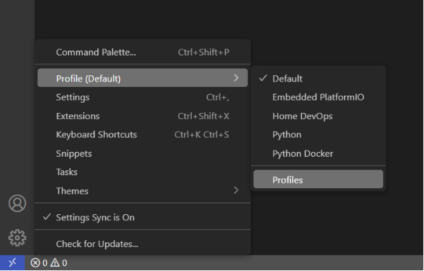
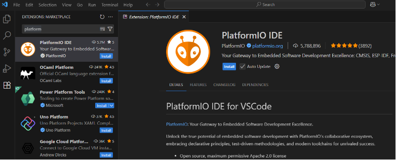
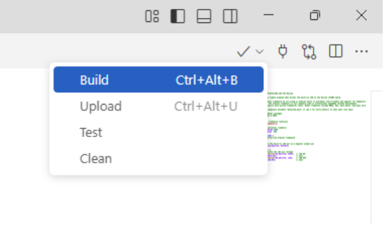

# Developer Workstation Setup

This document describes how to configure your host system to program the ST microcontroller.

It is assumed you have downloaded and installed [Microsoft VS Code](https://code.visualstudio.com/download) or [VSCodium](https://vscodium.com/).


## Installing the ST-Link Driver

> [!WARNING]
> Ensure your Nucleo board is NOT connected to your laptop during this step.

Unlike most consumer-grade USB devices where Windows is easily able to find drivers to communicate between the Windows OS and USB device, our microcontroller is not a regular USB device.
We need to manually install drivers so we can flash and debug our microcontroller.

`ST-Link` is a driver that tells Windows information about the USB connection.
This software also works in conjunction with a device called a “programmer” which is a piece of hardware that helps write code to our microcontroller (also called ST-Link).
Back in the day, we would have to buy this hardware separately and it wasn’t cheap.
Nowadays it is included on the dev board!

1. A quick Google search for "ST-Link Driver" shows ST's website for the [STSW-LINK009](https://www.st.com/en/development-tools/stsw-link009.html).
Download the driver - you may need a free ST account to do so.

2. Right-click the downloaded `.zip` file and select `Extract All…`.
The default file location and show extraction is fine. Click `Extract`. 

3. Find and run (double-click) the `dpinst_amd64.exe` installer.
Run the installer with default settings.
You can confirm the installation worked by plugging in your Nucleo board, opening the **Windows Device Manager**, and looking under Ports (COM and LPT) and Universal Serial Bus devices.

<p align="center">
    
</p>

4. Once the drivers are installed on your OS, you can delete the `stsw-link009.zip` file and the unzipped folder as we no longer need it.


## Configuring VS Code for the PlatformIO IDE

This section will introduce you to configuring your VS Code editor.
VS Code is a very powerful text editor that is granted IDE capabilities through extensions.
Because VS Code can be used for many different languages and projects, it is recommended to use VS Code Profiles to organize your IDE.

First, we will create a profile in VS Code to contain all our extensions and configurations.
Next, we will install some extensions into this profile to make it your "embedded programming" profile.

Launch VS Code.

---

1. VS Code is a text editor that can do MANY things once you install ***extensions***.
It is good to keep things organized.
We can create a ***profile*** in VS Code that we can use whenever we work on our embedded projects – profiles can have different settings, extensions, themes, and more.
In the future, you might have other profiles for Python projects, MATLAB, DevOps (server admin), Java, or just universal text editing.
Let’s create a profile for our embedded projects.

    In VS Code on the far bottom left, click the gear icon, select *Profile (Default)*, and then ***Profiles*** at the bottom of the list (yours will look a bit different than mine).

    This will open a new tab for all your profile settings.

    <p align="center">
        
    </p>

---

2. In the ***Profiles*** tab that pops up, click ***New Profile*** and give it a name like “Embedded” or similar.

    - You can select a fun icon if you want (this will change the little gear icon in the bottom left to this icon). 
    - Copy from “None” and set all source Contents to “None” (they should all be defaulted to “None”). 
    - Then click “Create”. 
    - You will see a new profile on the left side of the Profiles tab. Hover your mouse over it and click “***Use this profile in the current window***”.

    You might notice your theme or settings have changed – that is okay and you can reconfigure those (different themes for different profiles is nice to know what profile you are using at a glance).

    You can also change profiles from that gear icon in the bottom left of VS Code. We can re-use this profile by clicking that small gear icon in the bottom, selecting ***Profile (Default)*** and then selecting your new Embedded profile.

    You can now close the Profiles tab.

---

Now that we have a new profile to work in, let’s install some extensions!
Extensions are installed in ***each profile separately***!
You must have the profile active first, before you install extensions (otherwise they may install into the Default profile).

Ensure your Embedded profile is currently active (click the icon in the bottom left and it should say something like "Profile (Embedded)").


3. Open the extensions panel by clicking the stacked squares icon on the far left or pressing `CTRL + SHIFT + X`.
This shows all the extensions we can get for VS Code through Microsoft – some are official while others are community-made. If using VSCodium, you have a different extension system but they should be very similar.

    We will want a few and might come back for more! 
    Search for `PlatformIO` by *platformio.org* and install it – this will help us get all the files we need to write and run code on our Nucleo.
    The goal of PlatformIO is to be your one-stop-shop for all your embedded programming needs!
    If you ever have to use a different microcontroller, you can still use PlatformIO to program the board (usually).

    <p align="center">
        
    </p>

> [!TIP]
> When you are searching through extensions, skim the ***Details*** section of each extension to get an idea of what it does. Sometimes they have nice guides or animations.


4. Once the extension has been installed, you will see the PlatformIO icon in your left sidebar.
Click it and it will start installing the IDE.
You may see notifications in the bottom right corner, ignore those for now (UNLESS YOU SEE AN ERROR). Some errors occur because PlatformIO can't run its Python installer and setup - likely due to permissions.
After PlatformIO installs its IDE, we will need to restart VS Code. 

Close VS Code and reopen VS Code to 'restart it'.

> [!TIP]
> Opening VS Code fresh will always open the last project that was opened.
>
> Profiles are associated with folders. A fresh VS Code window might have the Default profile active and you may have to change it back to your Embedded. Later, when you open a configured project folder, VS Code will remember the profile that is linked to that folder.

---

Let's get a few more extensions.

5. Our PlatformIO IDE and VS Code is perfectly fine and ready for writing C and C++ code, but we can add some extra extensions to make it a bit nicer.
There are also extra extensions we can get to improve Markdown writing and rendering.
Search for and install the following extensions:

    - `C/C++ by Microsoft` – This extension adds a special program called a “Language Server”.
    It is a program that runs in the background and is always monitoring your project code files.
    This program helps us by providing information about functions and variables from other files in the project.
    It also helps provide red underline text when you type something C/C++ doesn’t like.
    You can think of this like a “code spell-checker”.
    When you hover your mouse over function names, the language server will show information about that function like a description and arguments. 
    This is also similar to Python’s dynamic introspection.

    - `GitHub Markdown Preview by Matt Bierner` – This is an extension pack of four other extensions.
    Installing this extension pack installs all four extensions.
    This pack adds special Markdown features that are not part of the original Markdown and are present on GitHub.com (it makes your Markdown look like it will on GitHub).

    - `Markdown Preview for Github Alerts by Yahya Batulu` – This is a nice extension that renders GitHub alerts in Markdown.
    Alerts are little text bubbles that can grab your reader’s attention.

        In these markdown files you may have noticed sections that look like:

        ```text
        > [!NOTE]
        > Some Text
        ```

        These are GitHub alert blocks. When you install this extension you should see pretty renders of those alert bubbles.

    - [Optional] `Auto-Open Markdown Preview by hnw` – A community extension to always automatically open Markdown previews in a side panel instead of having to right-click the Markdown file and select “Open Preview”.

    - [Optional] `C/C++ Extension UI Themes by Microsoft` – A extension that adds themes specialized in color-coding C/C++ code.

You can also change VS Code's color theme.
Click the settings in the bottom left and select "Theme".
This opens a little dialog at the top of VS Code (a lot of dialogs happen up here) which asks which theme you want.
You can install more themes via extensions (which then add them to this list).


## Running C Code on your Microcontroller

We have a configured profile with a working IDE (PlatformIO) ready to go in VS Code.

> [!NOTE]
> An `IDE` is an ***Integrated Development Environment***.
> IDEs are programs that contain all the tools needed to write code, interpret or build code, and debug code.
> You probably used **Spyder** as your Python IDE.
> There are many IDEs you can choose from - especially Python. You can also configure VS Code to run Python and manage virtual environments (although a tool like `uv` is better at that).

> [!IMPORTANT]
> Ensure your Embedded profile is active. You can check by clicking the little gear icon in the bottom left corner of VS Code and checking the Profile section.

There were many other folders and files in this repository.
These are mainly for PlatformIO. Below will describe what each of them do.

> [!NOTE]
> If you see a `/` in a name, it means the item is a folder (also known as a *directory*).

|Item|Description|
|-|-|
|`platformio.ini`|The configuration file for PlatformIO. If your project has this file in it, PlatformIO will see it and start configuring your IDE behind the scenes! The PlatformIO config file has ***very important information***! It specifies which microcontroller we are using, the software framework, the programming tool (ST-Link), and build flags (how the code should be compiled). This file is used to change the build configuration.|
|`mbed_app.json`|This is the configuration file for MBedOS. MBed handles a lot of common MCU tasks that makes it easier for programmers to get prototypes up and running quickly. For example, MBed can automatically configure the serial comms system (this template uses 115200 baud). We can use the `mbed_app.json` config to set some of those settings. This file also controls what modules MBed includes in the build (such as if printing floating-point code should be included). The template file provided should do most of what you want.|
|`.gitignore`|This file is used by git to *ignore* certain files and folders, thus prevent them from being tracked by the version control software. We can use this to prevent syncing sensitive files (like passwords) to GitHub. It also prevents things called “build artifacts” from getting into the version control. When we send code from our laptop to the Nucleo, it needs to create many ‘temporary’ files. We don’t want to sync these temp files! These temp files will live in the `.pio` folder (see below). I encourage you to open the `.gitignore` file and look inside. These are all the files and folder that will not be synced or source-controlled.|
|`.pio/` directory|This folder contains all the *build artifacts* when we compile our code. This folder is unique to every project and computer. We don’t need to interact with this folder.|
|`.vscode/` directory|Contains project-specific VS Code settings. That’s right! You can have different VS Code settings per project! Sometimes this contains themes, extensions, scripts, or keyboard shortcuts. This is usually unique to each person, but some large projects might force you to use certain extensions (like code formatting). This template repo has the `.vscode` directory in `.gitignore`.|
|`include/` directory|This folder is where we would put ***custom code*** we might find on the internet. Maybe we need custom code to get WiFi to work, or maybe a special digital sensor? “Including” code is like importing modules in Python. You can read the [`README`](../include/README) file inside the `include/` folder to get more info.|
|`lib/` directory|Short for *library*. Libraries are external code packages from the internet. It works together with the `include/` folder. You can read the `README` file inside the folder to get more info.|
|`src/` directory|Last, but not least, is the `src/` *source code* folder. This is where we put *our* code!! Inside you will see a file `main.cpp`. In the C language, most compilers expect one of your code files to have a `main()` function as the first code the CPU will execute (known as the `Entry Point`).

---

1. Open `src/main.cpp`. This is our C++ code that will execute on the microcontroller.

2. Plug in your Nucleo into your laptop.

3. In the top right corner of VS Code, look for a dropdown menu like the image below. Click “Build”. `Building` is the compilation process - a program called the `compiler` will convert our source code into machine code specifically for our MCU's CPU. You will see a new panel pop up on the bottom of VS Code that shows the building process.

    <p align="center">
        
    </p>

    You can also click on the checkmark icon at the very bottom of VS Code (these are PlatformIO widgets).

4. Let's inspect the build output.

    - PlatformIO scans your `main.cpp` code for other code it might need (which is a nice feature called “dependency analysis”). 
    - It then compiles a bunch of files. When source code is compiled, it becomes an ***object file*** `.o` first. Object files are half machine code, half human code. Somewhere in that list is our `main.cpp.o`! The other files are all required for this current project.
    - Towards the bottom of the build output you will see a line starting with ***Linking*** – this is an important step where all the `.o` files and libraries get merged into one `.elf` file. The `.elf` is mostly machine code but it is still organized in a human format - it is one step away from becoming pure machine code. This `.elf` file is mainly used for debugging and stepping through our code one line at a time.
    - The compilation process also reports the amount of memory (RAM) our program is expected to use as well as the amount of storage needed to contain the program (Flash).
    - Lastly, the `.elf` file is converted specifically for our MCU. All the debug information is thrown away and a single binary file `.bin` is created. Binary files can be read by a CPU.

> [!IMPORTANT]
> Saving code and building code **DO NOT** send code to the MCU. All we did was convert source code (text files) into machine code (a `.bin`) saved somewhere in the `.pio/` folder.

---

5. Now we need to move the code to our MCU (we need to *flash* the code to the MCU). To flash the chip, go back to the top right of VS Code where you clicked **Build**, but instead, click **Upload**.

    When you click **Upload**, it will both Build the code AND flash it to the MCU. Because we already built the code, it will see the files have not changed and skip the build process. In the future, you can just click **Upload** and it will do both steps. The last line in the terminal should say “SUCCESS” and how long it took to flash the chip. The moment the flash is complete, the program on your Nucleo starts running!

> [!IMPORTANT]
> Remember: you must save your code before you click the Build or Upload buttons.
>
> You do NOT need to commit your code before Building/Uploading. In general, only commit *working* code. If your code is not working when you perform a commit, consider adding "WIP" in the commit message - it stands for "Work in Progress" and tells others that they should not expect the code to work.

For running the debugger, see the [debugging.md](debugging.md) file in the `docs/` directory.
